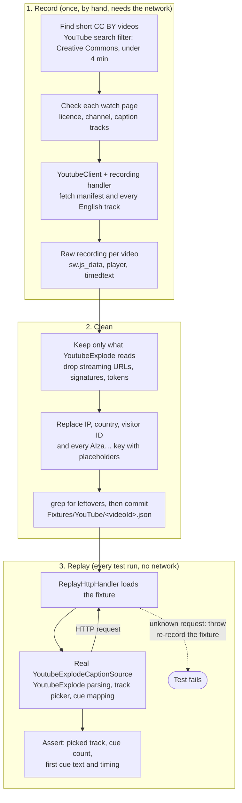

# YouTube replay fixtures

Recorded HTTP traffic of YoutubeExplode fetching captions, replayed by `ReplayHttpHandler` so the
caption adapter is tested end to end without the network. Recorded on 2026-11-12 with YoutubeExplode 6.6.3.

## How it works

The replay handler matches a request by method, path and the `v`, `lang` and `kind` query values. Other query
values (tokens, signatures) change on every call, so they're ignored. A request that appears more than once is
answered in recorded order.

## Videos (all CC BY 3.0, licence checked on the watch page on 2026-11-12)

Captions segmented and used as test data by Dictora. Licence: [CC BY 3.0](https://creativecommons.org/licenses/by/3.0/).

| File | Video | Channel | Length | Captions |
|------|-------|---------|--------|----------|
| `gmoDpj1jtyA.json` | [Change Management explained in 1 minute!](https://www.youtube.com/watch?v=gmoDpj1jtyA) | Gavin Wedell | 1:26 | zh-CN, manual en, auto en |
| `Gj26fmXCn9U.json` | [Power Copying Explained in 1 Minute](https://www.youtube.com/watch?v=Gj26fmXCn9U) | ExplainingPowers | 1:09 | auto en, manual en-US |
| `eklX9_LPkI0.json` | [English Conversations \| Small Talk \| 1. Greetings](https://www.youtube.com/watch?v=eklX9_LPkI0) | Learn by Translation - Çeviriyle Öğren | 0:27 | auto en only |
| `65iWtWqWmgY.json` | [Pronunciation Practice - Let's Learn English Lesson 1](https://www.youtube.com/watch?v=65iWtWqWmgY) | VOA Learning English | 0:30 | none |

## What was removed before committing
- Player responses keep only `playabilityStatus`, `captions` and `videoDetails` (no streaming URLs).
- URLs keep only the `v`, `lang` and `kind` query values (no signatures, keys or IP parameters).
- In `sw.js_data`, the requester's IP, country and visitor ID are replaced with placeholders.
- Every Google API key (`AIza…`) is replaced with `FIXTURE_PLACEHOLDER_KEY`, even YouTube's public web key,
  so secret scanning stays quiet. Check with `grep -r AIza` before committing a new recording.

## Re-recording
Needed when a YoutubeExplode update changes the requests it makes (the replay handler then fails with
"No recorded response for ..."). Record with a `DelegatingHandler` that saves each request's method and URL
and the response's status, content type and body, pass it to `new YoutubeClient(httpClient)`, fetch the
manifest and every English track, then apply the clean-up above. Only use CC BY videos.
